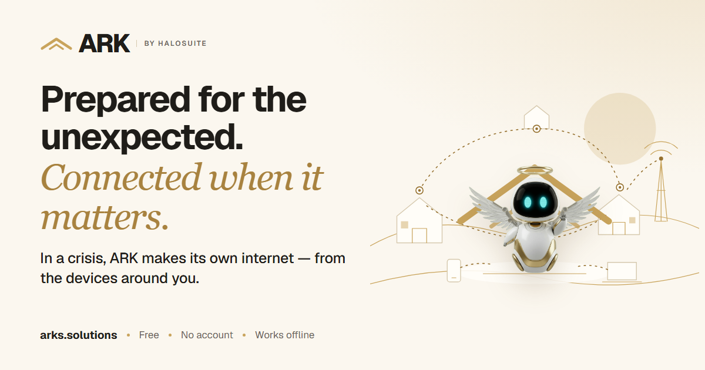

# ARK — Backup internet, AI & more for when crisis hits

**Prepared for the unexpected. Connected when it matters.**

**In a crisis, ARK makes its own internet from the devices around you.** When the network goes
down, the phones and laptops people already have link up into a local one: one laptop becomes the
hub, nearby phones join it over Wi-Fi, and hubs pass messages on to each other.

ARK is a free emergency toolkit, made by [HaloSuite](https://halosuite.ai): a household plan,
first-aid and survival guides, a built-in assistant, offline maps, and local messaging.

**→ Use it now: [arks.solutions](https://arks.solutions)**



> **ARK is not an emergency service and nobody monitors it.** In immediate danger, call 911 (or
> your local emergency number). The guidance comes from public sources (Red Cross, AHA, CDC, FEMA)
> and is a reference, not a substitute for training or professional care.

---

## Get ready in ten minutes

| Step | What to do |
|---|---|
| 1. Save ARK | Open **[arks.solutions/app](https://arks.solutions/app)** on your phone and add it to your home screen. Or tap **Save & Share ARK** to keep it as a single file. |
| 2. Fill in your plan | Household, emergency contacts, medicines, meeting places. Print the emergency card. |
| 3. Share it | Send the link or the file to family and neighbours. |
| 4. Set up a hub (optional) | To exchange messages with **no internet**, put the ARK Hub on one laptop: **[arks.solutions/hub](https://arks.solutions/hub)**. Practise once. |

Do it before you need it.

## What works with no internet

| Part | What it does | Needs |
|---|---|---|
| **The app** (`ARK-CRISIS-SUITE.html`) | Plan, contacts, guides, Ask Halo assistant, CPR timer, supplies, map, radio tools, missing-person records, backup | Nothing. One file, any browser. |
| **ARK Hub** (`src/hub/`) | A laptop or Raspberry Pi hosts a shared message board and the app for every phone on its Wi-Fi | Power, and a Wi-Fi router or hotspot (no internet required) |
| **Radio and SMS bridges** (`src/toolkit/`) | Carry hub messages over Meshtastic radio or SMS | Optional hardware |
| **Paper** | Printed emergency card and guides | A printer, beforehand |

A phone cannot be a hub by itself — browsers cannot accept connections from other devices. The hub
is a small program you start on a laptop; everyone else just types its address into a browser.

## Repository layout

| Path | What it is |
|---|---|
| `ARK-CRISIS-SUITE.html` | **The app**, built — one self-contained file you can download and open. |
| `app/src/` | The app's source: one small file per screen and feature, joined by `scripts/build.py` |
| `web/` | The website: welcome page, hub and connect pages, PHP front door, offline service worker |
| `src/hub/` | ARK Hub — the no-internet community server ([guide](src/hub/HUB-GUIDE.md)) |
| `src/toolkit/` | Radio (Meshtastic) and SMS bridges ([guide](src/toolkit/README.md)) |
| `src/content/` | Reference text for guides and emergency contacts |
| `kit/` | Starter files that ship in the hub kit |
| `scripts/` | `build.py` (app, website, hub kit) · `make-og-image.py` (link preview) |
| `docs/` | [Architecture](docs/ARCHITECTURE.md) · [Deploying](docs/DEPLOY.md) · [Backlog](docs/BACKLOG.md) |
| `PROTOCOL.md` | ARK-RELAY-1, the signed message format hubs exchange |

**Want to help?** Start with [CONTRIBUTING.md](CONTRIBUTING.md). `main` is the only branch.

## Build and check

```bash
python scripts/build.py --app-only    # rebuild ARK-CRISIS-SUITE.html from app/src/
node src/hub/selftest.mjs             # hub: signing, storage, bundles
node src/hub/selftest-extended.mjs    # hub: extended checks
node src/toolkit/selftest.mjs         # toolkit: signing
python scripts/build.py --with-node   # website folder + hub kit (in build/)
```

Requirements: Node.js 20+ and Python 3.9+. No npm or pip packages.

## Why one HTML file?

1. **Works offline** — from a USB stick, a saved file, or a hub on local Wi-Fi.
2. **Nothing to install** — share it by text, email, AirDrop or SD card.
3. **Runs anywhere** — any static host, or no host at all.
4. **Can be inspected** — emergency software should be readable by anyone.

## For emergency services and agencies

Organisations that help people in an emergency can ask to link with ARK — to share verified local
information or connect their own hub: **[arks.solutions/connect](https://arks.solutions/connect)**.

## Safety, privacy and limits

- What you type stays on your device. There are no accounts, analytics or trackers.
- A hub's message board is **public and unencrypted** to everyone on that Wi-Fi.
- No delivery is guaranteed. A "seen" count means people read a message, not that help is coming.
- Official fixes can be sent from arks.solutions to running copies. They can change wording and
  styling only; they cannot run code or touch saved data, and hubs cannot send them.
- ARK never spreads itself, runs hidden, or collects data.

## Licence

[MIT](LICENSE). A gift from [HaloSuite](https://halosuite.ai) — safety should not have a paywall.
Contact: hello@halosuite.ai
